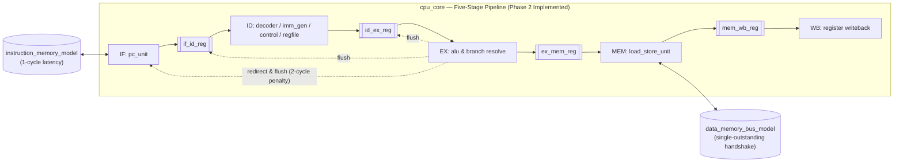

# RV32I RISC-V SoC — Design and Verification

A 32-bit RV32I RISC-V system-on-chip with a five-stage pipelined CPU (IF, ID, EX, MEM, WB), memory-mapped peripherals (UART, SPI master, 32-bit timer, interrupt controller), and a planned open-source RTL-to-GDSII ASIC flow.

> **Project Status: Phase 2 — RV32I Five-Stage Pipelined Processor (Completed)**  
> All 12 synthesizable SystemVerilog CPU-core modules (`rtl/core/`), simulation-only memory models (`testbench/models/`), self-checking unit testbenches (`testbench/unit/`), system testbench (`testbench/system/`), and assembly test programs (`programs/`) are implemented and ready for verification.

---

## Development Phases & Progress

| Phase | Description | Status | Deliverables / Artifacts |
|---|---|---|---|
| **Phase 1** | **Project Foundation & Architecture** | **Completed** | Specifications, memory map, pipeline diagrams, verification plan |
| **Phase 2** | **RV32I Pipelined Processor Core** | **Completed** | 12 synthesizable RTL modules, unit/system TBs, models, assembly tests |
| **Phase 3** | Hazard Detection & Forwarding | Planned | `hazard_unit.sv`, `forwarding_unit.sv`, hazard verification without NOPs |
| **Phase 4** | Memory Subsystem & Peripheral Integration | Planned | Bus interconnect, SRAM controllers, UART, SPI, Timer, IRQ controller |
| **Phase 5** | Verification & Validation | Planned | Full RV32I test suite, random regression vs reference ISS, coverage |
| **Phase 6** | Synthesis & Physical Design | Planned | Yosys synthesis, OpenROAD P&R, SDC constraints, SkyWater 130nm GDSII |
| **Phase 7** | Optimization & Final Sign-off | Planned | Timing/area optimization, power analysis, final documentation |

---

## Phase 2 Highlights & Core Architecture

The CPU core (`cpu_core.sv`) implements an in-order, five-stage pipeline executing the unprivileged **RV32I Base Integer ISA** (37 instructions plus FENCE, ECALL, and EBREAK decoding).



### Core Architecture Specifications:
- **Architecture:** 32-bit RISC-V RV32I Base Integer ISA.
- **Pipeline:** 5-stage in-order datapath: Instruction Fetch (**IF**), Instruction Decode (**ID**), Execute (**EX**), Memory Access (**MEM**), and Write Back (**WB**).
- **Register File:** 32 general-purpose 32-bit registers (`x0` through `x31`). Dual combinational read ports, single synchronous rising-edge write port. Register `x0` is permanently hardwired to `32'h0000_0000` and ignores all writes.
- **Branch/Jump Handling:** Branches and jumps evaluate and resolve in **EX** stage. Static not-taken fetch policy. Redirections flush `IF/ID` and `ID/EX` pipeline registers with a clean 2-cycle penalty.
- **Memory Interfaces:** Dedicated instruction fetch interface and custom single-outstanding-transaction data bus master interface (`req`, `addr`, `we`, `wdata`, `be`, `ready`, `rdata`, `error`).
- **Phase 2 Hazard Baseline:** Strict phase boundary — hardware forwarding and dynamic hazard detection units belong to Phase 3. Software programs in Phase 2 insert 3 `NOP` instructions between dependent instructions for safe in-order execution.

---

## Implemented CPU Core Modules (`rtl/core/`)

| # | Module | Stage | Description |
|---|---|---|---|
| 1 | `pc_unit.sv` | IF | Holds PC, generates sequential `PC+4`, resolves branch/jump targets, supports stall |
| 2 | `if_id_reg.sv` | IF/ID | Pipeline register for valid bit, PC, PC+4, and 32-bit instruction with stall and flush |
| 3 | `instruction_decoder.sv` | ID | Slices opcode, rd, funct3, rs1, rs2, funct7; validates encodings and flags illegal instructions |
| 4 | `immediate_generator.sv` | ID | Immediate sign/zero extension for I, S, B, U, and J formats with bit 0 alignment |
| 5 | `control_unit.sv` | ID | Decodes ALU operations, operand mux selects, memory read/write, reg-write, and branch/jump |
| 6 | `register_file.sv` | ID/WB | 32x32-bit integer register file (dual read, synchronous write, x0 hardwired to zero) |
| 7 | `id_ex_reg.sv` | ID/EX | Pipeline register for operands, immediate, control signals, and destination register |
| 8 | `alu.sv` | EX | ADD, SUB (overflow wrap), AND, OR, XOR, SLL, SRL, SRA, SLT, SLTU, and branch comparisons |
| 9 | `ex_mem_reg.sv` | EX/MEM | Pipeline register for ALU result, store data, destination register, and memory controls |
| 10 | `load_store_unit.sv` | MEM | Memory bus master: LB, LH, LW, LBU, LHU, SB, SH, SW, byte enables (`be[3:0]`), bus handshake |
| 11 | `mem_wb_reg.sv` | MEM/WB | Pipeline register multiplexing writeback data (ALU, Memory load, PC+4) and write-enable |
| 12 | `cpu_core.sv` | Top Core | Top-level five-stage CPU core pipeline integration wrapper |

---

## Verification Suite & Simulation Models

### Simulation Memory Models (`testbench/models/`)
- `instruction_memory_model.sv` — Behavioral instruction RAM model with 1-cycle synchronous read latency and dynamic program loading.
- `data_memory_bus_model.sv` — Behavioral byte-addressable memory bus slave conforming to the custom handshake protocol with configurable wait states.

### Self-Checking Unit Testbenches (`testbench/unit/`)
- `tb_alu.sv` — Arithmetic overflow wraparound, logical operations, shift amounts (0, 1, 31), signed/unsigned comparisons, and branch conditions.
- `tb_register_file.sv` — Full read/write sweep of x1..x31, simultaneous dual-port reads, x0 write immunity, reset clearing.
- `tb_instruction_decoder.sv` — Decode field extraction across R, I, S, B, U, J types and illegal instruction rejection.
- `tb_immediate_generator.sv` — All 5 immediate formats, sign extensions, and boundary bit placement.
- `tb_control_unit.sv` — Complete control matrix verification and isolation of illegal instructions.
- `tb_pipeline_registers.sv` — Reset clearing, normal advancement, stall hold, and flush bubble insertion across all 4 pipeline registers.
- `tb_load_store_unit.sv` — All load/store sizes, byte enables, bus stall states, and error responses.

### System-Level CPU Testbench (`testbench/system/`)
- `tb_cpu_core.sv` — Complete system integration running assembly programs, asserting architectural register states, memory store/load verification, branch redirection checks, and watchdog timeout protection.

---

## Repository Structure

```
.
├── rtl/
│   └── core/                     # 12 synthesizable SystemVerilog CPU core modules
├── testbench/
│   ├── unit/                     # 7 self-checking unit testbenches
│   ├── system/                   # System-level CPU core testbench (tb_cpu_core.sv)
│   └── models/                   # Simulation memory models (IMEM, DMEM bus slave)
├── programs/
│   ├── asm/                      # Assembly test programs (phase2_smoke.s, phase2_branch.s)
│   ├── hex/                      # Machine-code hex files for simulation loading
│   └── linker/                   # Linker script
├── scripts/
│   ├── run_phase2_sim.sh         # Linux/macOS simulation suite runner (Icarus Verilog)
│   ├── lint_phase2.sh            # Verilator lint runner
│   └── run_phase2_sim.ps1        # Windows PowerShell simulation runner
├── docs/
│   ├── phase2_implementation_decisions.md  # Phase 2 architectural decisions & baseline
│   ├── phase2_rtl_architecture.md          # Datapath, pipeline stages, and module interfaces
│   ├── phase2_test_results.md              # Test execution status and procedures
│   ├── architecture.md                     # SoC hierarchy and interconnect
│   ├── pipeline_architecture.md            # Five-stage pipeline specification
│   ├── module_specification.md             # 22-module SoC inventory & implementation status
│   ├── instruction_set.md                  # RV32I base integer specification
│   ├── memory_map.md                       # Memory address space and peripheral mapping
│   ├── verification_plan.md                # Verification plan & test scenarios
│   └── development_roadmap.md              # Seven-phase development roadmap
├── reports/
│   └── simulation/phase2/        # Simulation logs and report templates
├── constraints/                  # SDC timing constraints template
├── synthesis/                    # Yosys synthesis scripts template
├── physical_design/              # OpenROAD physical design configuration template
├── Makefile                      # Make orchestration for compilation, lint, and test
├── PHASE2_README.md              # Standalone Phase 2 package documentation
├── PHASE2_CHANGELOG.md           # Implementation changelog and phase boundaries record
└── RV32I_Phase2_Pipelined_Processor.zip # Downloadable hardware release package
```

---

## How to Run Simulations

### Prerequisites
- [Icarus Verilog](https://steveicarus.github.io/iverilog/) (`iverilog` and `vvp`) with SystemVerilog support (`-g2012`).
- Optional: [Verilator](https://www.veripool.org/verilator/) for linting.

### Linux / macOS
```bash
# Make scripts executable
chmod +x scripts/run_phase2_sim.sh scripts/lint_phase2.sh

# Run all Phase 2 unit and system simulations:
./scripts/run_phase2_sim.sh all

# Or run specific testbenches:
./scripts/run_phase2_sim.sh tb_alu
./scripts/run_phase2_sim.sh tb_cpu_core

# Or using Makefile:
make test
```

### Windows (PowerShell)
```powershell
# Run all Phase 2 tests
.\scripts\run_phase2_sim.ps1 -TargetTest all

# Run specific testbench
.\scripts\run_phase2_sim.ps1 -TargetTest tb_alu
```

---

## Engineering Rules

- A module is marked **Implemented** only when its RTL source code is committed.
- A test is marked **Verified / Passed** only when a real simulator execution log is committed in `reports/`.
- No estimated, fabricated, or mock results are committed.
- Synthesizable RTL in `rtl/` strictly adheres to digital VLSI synthesis standards (no behavioral constructs, no inferred latches, synchronous resets).

---

## Author

**Harshvardhan Salvi**  
Electronics and Communication Engineering / VLSI Design
