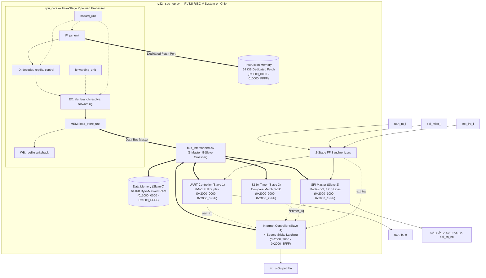

# RV32I RISC-V SoC — Design and Verification

A 32-bit RV32I RISC-V System-on-Chip (SoC) featuring an in-order five-stage pipelined CPU (IF, ID, EX, MEM, WB), hardware hazard detection, full data forwarding, a 64 KiB instruction memory, a 64 KiB byte-masked data memory, a custom single-master 5-slave crossbar interconnect, and memory-mapped peripherals (UART, SPI Master, 32-bit Timer, Interrupt Controller).

> **Project Status: Phase 4 — Memory Subsystem and Peripheral Integration (Completed)**  
> Full SoC top-level (`rv32i_soc_top.sv`) integrates the five-stage RV32I processor with dedicated 64 KiB instruction RAM, 64 KiB byte-masked data RAM, a custom bus interconnect, UART (8-N-1), SPI Master (Modes 0-3, 4 CS lines), 32-bit Hardware Timer, 4-source Interrupt Controller, and 2-stage flip-flop synchronizers for asynchronous external inputs. Complete self-checking unit and system test suites, assembly test firmware, ratified linker scripts, and simulation scripts are in place.

---

## Development Phases & Progress

| Phase | Description | Status | Deliverables / Artifacts |
|---|---|---|---|
| **Phase 1** | **Project Foundation & Architecture** | **Completed** | Specifications, memory map, pipeline diagrams, verification plan |
| **Phase 2** | **RV32I Pipelined Processor Core** | **Completed** | 12 synthesizable RTL modules, unit/system TBs, models, assembly tests |
| **Phase 3** | **Hazard Detection & Forwarding** | **Completed** | `hazard_unit.sv`, `forwarding_unit.sv`, CPU integration, self-checking TBs, programs without NOPs |
| **Phase 4** | **Memory Subsystem & Peripheral Integration** | **Completed** | 64K IMEM, 64K DMEM, bus interconnect, UART, SPI, Timer, INTC, `rv32i_soc_top`, 9 TBs, firmware |
| **Phase 5** | Verification & Validation | Planned | Official riscv-arch-test suite, random regression vs reference ISS, coverage |
| **Phase 6** | Synthesis & Physical Design | Planned | Yosys synthesis, OpenROAD P&R, SDC constraints, SkyWater 130nm GDSII |
| **Phase 7** | Optimization & Final Sign-off | Planned | Timing/area optimization, power analysis, final documentation |

---

## System Architecture: Complete Phase 4 SoC



---

## Memory Map (Ratified)

| Region | Start Address | End Address | Size | Target / Slave Select | Access Permissions |
|---|---|---|---|---|---|
| **Instruction Memory** | `0x0000_0000` | `0x0000_FFFF` | 64 KiB | Dedicated Fetch Port | Read-Only (Fetch) |
| **Data Memory** | `0x1000_0000` | `0x1000_FFFF` | 64 KiB | `s0` (Slave 0) | Read / Write (Byte masked) |
| **UART Controller** | `0x2000_0000` | `0x2000_0FFF` | 4 KiB | `s1` (Slave 1) | Read / Write (MMIO) |
| **SPI Master** | `0x2000_1000` | `0x2000_1FFF` | 4 KiB | `s2` (Slave 2) | Read / Write (MMIO) |
| **Timer** | `0x2000_2000` | `0x2000_2FFF` | 4 KiB | `s3` (Slave 3) | Read / Write (MMIO) |
| **Interrupt Controller**| `0x2000_3000` | `0x2000_3FFF` | 4 KiB | `s4` (Slave 4) | Read / Write (MMIO) |
| **Unmapped Space** | *All other addresses* | — | — | Unmapped Logic | Returns `ready=1`, `error=1`, `rdata=0` |

---

## Complete Hardware Modules Inventory

### 1. CPU Core (`rtl/core/`)
| Module | Stage / Role | Description |
|---|---|---|
| `pc_unit.sv` | IF | Program counter management, PC+4, branch/jump redirect, hold on stall |
| `if_id_reg.sv` | IF/ID | Pipeline register for instruction and PC with synchronous stall and flush |
| `instruction_decoder.sv` | ID | Slices opcode, rd, funct3, rs1, rs2, funct7, funct12; flags illegal opcodes |
| `immediate_generator.sv` | ID | Sign/zero extension for I, S, B, U, and J formats |
| `control_unit.sv` | ID | Decode generating ALU op, operand selects, memory, ECALL/EBREAK signals |
| `register_file.sv` | ID/WB | 32x32-bit registers (dual combinational read, synchronous write, x0=0) |
| `id_ex_reg.sv` | ID/EX | Pipeline register for operands, immediates, controls with stall & bubble flush |
| `alu.sv` | EX | Arithmetic, logic, shifts, set-less-than, and branch comparison operations |
| `ex_mem_reg.sv` | EX/MEM | Pipeline register for ALU result, forwarded store data, and memory controls |
| `load_store_unit.sv` | MEM | Memory bus master: LB/LH/LW/LBU/LHU, SB/SH/SW, byte enables, handshake |
| `mem_wb_reg.sv` | MEM/WB | Pipeline register multiplexing writeback data (ALU, load data, PC+4) |
| `hazard_unit.sv` | Control | Load-use hazard detection, stall/bubble insertion, control flush, LSU busy hold |
| `forwarding_unit.sv` | Control | RAW hazard resolution with priority-based EX/MEM and MEM/WB operand forwarding |
| `cpu_core.sv` | Core Top | Top-level integration of 5-stage pipeline, forwarding muxes, and hazard logic |

### 2. Memory Subsystem (`rtl/memory/`)
| Module | Role | Description |
|---|---|---|
| `instruction_memory.sv` | Memory | 64 KiB dedicated synchronous instruction memory (1-cycle read latency) |
| `data_memory.sv` | Memory | 64 KiB byte-addressable synchronous RAM with 4-bit byte enables (`be_i[3:0]`) |

### 3. Bus Interconnect (`rtl/bus/`)
| Module | Role | Description |
|---|---|---|
| `bus_interconnect.sv` | Interconnect | 1-Master, 5-Slave crossbar decoder, response mux, and unmapped error trap |

### 4. Peripherals & Top Integration (`rtl/peripherals/`, `rtl/top/`)
| Module | Role | Description |
|---|---|---|
| `uart_controller.sv` | Peripheral | 8-N-1 UART with baud prescaler, TX/RX FSMs, overrun/frame error, IRQ |
| `spi_master.sv` | Peripheral | Motorola Modes 0-3 SPI Master, 4 CS lines, full duplex, IRQ |
| `timer.sv` | Peripheral | 32-bit hardware timer with compare match threshold, sticky status, W1C |
| `interrupt_controller.sv` | Peripheral | 4-channel sticky pending, mask enable, W1C clear, aggregated IRQ output |
| `rv32i_soc_top.sv` | SoC Top | Top-level SoC integrating CPU, memories, bus, peripherals, and 2-flop syncs |

---

## Verification & Testing Suite

### Unit Testbenches (`testbench/unit/`)
- `tb_instruction_memory.sv` — 1-cycle latency, bounds checking, alignment rejection, preload.
- `tb_data_memory.sv` — Byte, halfword, and word operations via `be_i[3:0]`, boundary validation.
- `tb_bus_interconnect.sv` — Address decoding across all 5 slaves, unmapped space error.
- `tb_uart_controller.sv` — Baud generation, TX framing, RX center-sampling, overrun, IRQ.
- `tb_spi_master.sv` — Modes 0-3, 8-bit full duplex, chip select assertion, clock prescaler.
- `tb_timer.sv` — Counting, compare match, sticky status, W1C clear, IRQ output.
- `tb_interrupt_controller.sv` — Event latching, masking, W1C clear, set-over-clear priority.
- `tb_hazard_unit.sv`, `tb_forwarding_unit.sv`, `tb_alu.sv`, `tb_register_file.sv`, etc.

### System Testbenches (`testbench/system/`)
- `tb_soc_bus_integration.sv` — Bus master access to Data Memory and all 4 peripherals through interconnect.
- `tb_rv32i_soc_top.sv` — Full SoC top testbench executing genuine RV32I instructions, data memory load/stores, MMIO timer/intc configuration, IRQ assertion, and 2-flop synchronizers.
- `tb_hazard_integration.sv`, `tb_cpu_forwarding.sv`, `tb_cpu_core.sv`.

---

## How to Run Simulations Locally

```bash
# Run all Phase 4 unit and system simulations
bash scripts/run_phase4_sim.sh

# Or via Makefile
make test_phase4

# Run Verilator lint checks
bash scripts/lint_phase4.sh

# Build assembly firmware hex files
bash scripts/build_firmware.sh
```
