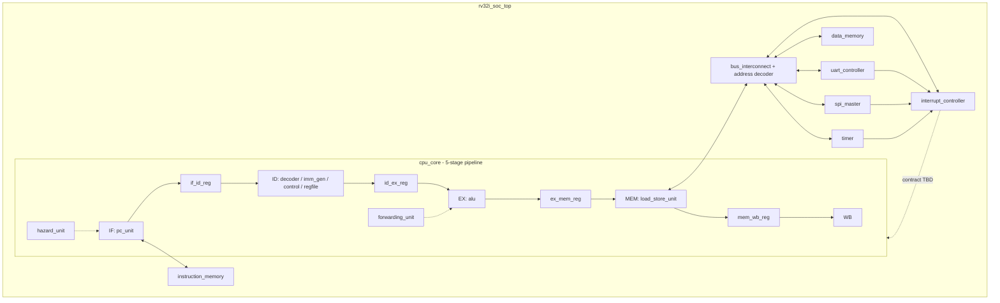

# RV32I RISC-V SoC — Design and Verification

A 32-bit RV32I RISC-V system-on-chip with a five-stage pipelined CPU (IF, ID, EX, MEM, WB), memory-mapped peripherals (UART, SPI master, 32-bit timer, interrupt controller), and a planned open-source RTL-to-GDSII ASIC flow.

> **Project status: Phase 1 — Foundation and Architecture.**
> This repository contains specifications, diagrams, plans and tool configuration templates. **No RTL has been written yet, no simulation has been run, and no synthesis, timing, area, power or GDSII results exist.** Every undecided parameter is marked **TBD**.

## Architecture overview



## Repository layout

```
rtl/              Synthesizable SystemVerilog (empty until Phase 2)
testbench/        Unit and system testbenches (Phase 2+)
programs/         RV32I assembly test programs and linker script
constraints/      SDC timing constraints (template)
scripts/          Simulation, lint and flow helper scripts
synthesis/        Yosys scripts (template)
physical_design/  OpenROAD flow configuration (template)
reports/          Only real tool outputs are committed here
docs/             Specifications, plans and Mermaid diagrams
```

## Documentation

| Document | Content |
|---|---|
| [Project scope](docs/project_scope.md) | Goals, in/out of scope, assumptions |
| [Architecture](docs/architecture.md) | SoC hierarchy and data paths |
| [Pipeline](docs/pipeline_architecture.md) | Stages, pipeline registers, hazards |
| [Module specification](docs/module_specification.md) | 22-module inventory |
| [Instruction set](docs/instruction_set.md) | RV32I instructions supported |
| [Memory map](docs/memory_map.md) | Address regions and peripheral registers |
| [Verification plan](docs/verification_plan.md) | Test scenarios and expected results |
| [Synthesis and PD preparation](docs/synthesis_and_physical_design.md) | Flow, configs, report policy |
| [Development roadmap](docs/development_roadmap.md) | Seven phases and acceptance criteria |
| [Phase 1 checklist](docs/phase1_acceptance_checklist.md) | Sign-off checklist |

## Development phases

1. Project Foundation and Architecture — *in progress*
2. RV32I Pipelined Processor
3. Hazard Detection and Forwarding
4. Memory Subsystem and Peripheral Integration
5. Verification and Validation
6. Synthesis and Physical Design
7. Optimization and Final Documentation

## Planned toolchain (versions TBD)

Icarus Verilog / Verilator (simulation, lint), GTKWave (waveforms), RISC-V GNU toolchain (`riscv32-unknown-elf`), Yosys (synthesis), OpenSTA (timing), OpenROAD / OpenLane (place and route), Magic / KLayout / Netgen (DRC, LVS, GDSII). Target PDK is TBD (SkyWater SKY130 is a candidate).

## Engineering rules

- A module is "Implemented" only when its RTL is committed; "Verified" only when a real simulation log is in `reports/`.
- Results are never estimated or invented. Every report records the commit, tool version, command and seed.
- RTL is synthesizable SystemVerilog. No behavioural CPU models in `rtl/`.

## Author

Harshvardhan Salvi — Electronics and Communication Engineering.

## License

TBD.
