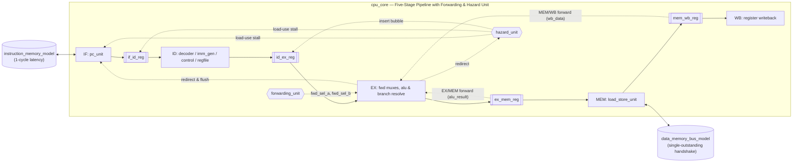

# RV32I RISC-V SoC — Design and Verification

A 32-bit RV32I RISC-V system-on-chip with a five-stage pipelined CPU (IF, ID, EX, MEM, WB), hardware hazard detection, full data forwarding, memory-mapped peripherals (UART, SPI master, 32-bit timer, interrupt controller), and a planned open-source RTL-to-GDSII ASIC flow.

> **Project Status: Phase 3 — Hazard Detection and Forwarding (Completed & Audited)**  
> Synthesizable `hazard_unit.sv` and `forwarding_unit.sv` integrated into `cpu_core.sv`. Hardware hazard resolution for RAW dependencies, load-use data hazards (1-cycle bubble), branch/jump control hazards (2-cycle flush), and LSU bus wait states allows RV32I programs to execute without software NOP insertion. All modules audited and corrected for ECALL/EBREAK distinction, JALR immediate dependencies, and memory wait-state coordination.

---

## Development Phases & Progress

| Phase | Description | Status | Deliverables / Artifacts |
|---|---|---|---|
| **Phase 1** | **Project Foundation & Architecture** | **Completed** | Specifications, memory map, pipeline diagrams, verification plan |
| **Phase 2** | **RV32I Pipelined Processor Core** | **Completed** | 12 synthesizable RTL modules, unit/system TBs, models, assembly tests |
| **Phase 3** | **Hazard Detection & Forwarding** | **Completed** | `hazard_unit.sv`, `forwarding_unit.sv`, CPU integration, self-checking TBs, programs without NOPs |
| **Phase 4** | Memory Subsystem & Peripheral Integration | Planned | Bus interconnect, SRAM controllers, UART, SPI, Timer, IRQ controller |
| **Phase 5** | Verification & Validation | Planned | Full RV32I test suite, random regression vs reference ISS, coverage |
| **Phase 6** | Synthesis & Physical Design | Planned | Yosys synthesis, OpenROAD P&R, SDC constraints, SkyWater 130nm GDSII |
| **Phase 7** | Optimization & Final Sign-off | Planned | Timing/area optimization, power analysis, final documentation |

---

## Phase 3 Architecture: Hazard Detection & Forwarding

The CPU core (`cpu_core.sv`) integrates full data forwarding and dynamic hazard detection across its five-stage pipeline:



### Core Architecture Highlights:
- **Architecture:** 32-bit RISC-V RV32I Base Integer ISA.
- **Pipeline:** 5-stage in-order datapath: Instruction Fetch (**IF**), Instruction Decode (**ID**), Execute (**EX**), Memory Access (**MEM**), and Write Back (**WB**).
- **Hazard Detection (`hazard_unit.sv`):**
  - **Load-Use RAW Hazards:** Automatically holds PC and `if_id_reg` while inserting exactly one bubble into `id_ex_reg`. In the subsequent cycle, the loaded value is forwarded directly from MEM/WB.
  - **Control Hazards:** Taken branches and jumps resolve in EX, redirecting PC and cleanly flushing `if_id_reg` and `id_ex_reg` (2-cycle branch penalty).
  - **Bus Wait States:** When `load_store_unit` asserts `lsu_busy`, the entire pipeline is frozen synchronously without losing redirect or hazard state.
- **Data Forwarding (`forwarding_unit.sv`):**
  - **EX/MEM → EX Forwarding (Priority 1):** Bypasses 1-cycle-old ALU results directly into ALU operands `op_a` and `op_b`.
  - **MEM/WB → EX Forwarding (Priority 2):** Bypasses 2-cycle-old ALU or load results into ALU operands.
  - **Store Data Forwarding:** Bypasses freshly computed results into `rs2_data` of `ex_mem_reg` for back-to-back ALU-to-Store operations.
  - **Branch Operand Forwarding:** Conditional branch evaluations (BEQ/BNE/BLT/BGE/BLTU/BGEU) evaluate forwarded operands immediately in EX.
  - **JALR Target Forwarding:** Base register for JALR calculation uses forwarded values, supporting immediate dependencies (`ADDI` -> `JALR`).
  - **x0 Protection:** Register `x0` is hardwired to 0 and explicitly ignored by all forwarding and hazard logic.
- **System Instructions:**
  - `instruction_decoder.sv` and `control_unit.sv` distinguish ECALL (`funct12 = 12'h000`) and EBREAK (`funct12 = 12'h001`) with zero write side effects.

---

## Hardware Modules Inventory (`rtl/core/`)

| # | Module | Stage / Role | Description |
|---|---|---|---|
| 1 | `pc_unit.sv` | IF | Program counter management, sequential PC+4, branch/jump redirect, hold on stall |
| 2 | `if_id_reg.sv` | IF/ID | Pipeline register for instruction, PC, PC+4 with synchronous stall and flush |
| 3 | `instruction_decoder.sv` | ID | Slices opcode, rd, funct3, rs1, rs2, funct7, funct12; flags illegal opcodes |
| 4 | `immediate_generator.sv` | ID | Immediate sign/zero extension for I, S, B, U, and J formats |
| 5 | `control_unit.sv` | ID | Main decode generating ALU op, operand selects, memory, ECALL/EBREAK, and control signals |
| 6 | `register_file.sv` | ID/WB | 32x32-bit general purpose registers (dual combinational read, synchronous write, x0=0) |
| 7 | `id_ex_reg.sv` | ID/EX | Pipeline register for operands, immediates, control signals with stall and bubble flush |
| 8 | `alu.sv` | EX | Arithmetic, logic, shifts, set-less-than, and branch comparison operations |
| 9 | `ex_mem_reg.sv` | EX/MEM | Pipeline register for ALU result, forwarded store data, and memory controls |
| 10 | `load_store_unit.sv` | MEM | Memory bus master: LB, LH, LW, LBU, LHU, SB, SH, SW, byte enables, and bus handshake |
| 11 | `mem_wb_reg.sv` | MEM/WB | Pipeline register multiplexing writeback data (ALU, load data, PC+4) |
| 12 | `hazard_unit.sv` | Control | Load-use hazard detection, stall/bubble generation, control flush, LSU busy priority |
| 13 | `forwarding_unit.sv` | Control | RAW hazard resolution with priority-based EX/MEM and MEM/WB operand forwarding |
| 14 | `cpu_core.sv` | Top Core | Top-level integration of 5-stage pipeline, forwarding muxes, and hazard logic |

---

## Verification & Testing Suite

### Unit Testbenches (`testbench/unit/`)
- `tb_hazard_unit.sv` — Self-checking testbench covering 12 hazard detection scenarios (`HAZARD-01..12`).
- `tb_forwarding_unit.sv` — Extended testbench covering 20 forwarding scenarios (`FORWARD-01..20`).
- `tb_instruction_decoder.sv` — Tests RV32I encodings, ECALL (`32'h00000073`), EBREAK (`32'h00100073`), and illegal system encodings.
- `tb_control_unit.sv` — Tests control signals, ECALL/EBREAK discrimination, and illegal instruction suppression.
- `tb_alu.sv`, `tb_register_file.sv`, `tb_immediate_generator.sv`, `tb_pipeline_registers.sv`, `tb_load_store_unit.sv`.

### System & Integration Testbenches (`testbench/system/`)
- `tb_hazard_integration.sv` — Verifies RAW dependency chains, cycle-level load-use stall bubble assertion (exactly 1 bubble), multi-cycle wait states (`WAIT_CYCLES = 2`), and branch redirect during outstanding memory load.
- `tb_cpu_forwarding.sv` — Verifies EX/MEM and MEM/WB forwarding paths, branch operand forwarding, immediate JALR base forwarding (`ADDI` -> `JALR`), register x0 immunity, and back-to-back producer priority.
- `tb_cpu_core.sv` — Baseline CPU core pipeline execution testbench.

---

## How to Run Simulations Locally

```bash
# Run all Phase 3 unit and integration tests
bash scripts/run_phase3_sim.sh

# Or using Make
make test_phase3

# Run Verilator lint checks
bash scripts/lint_phase3.sh
```
