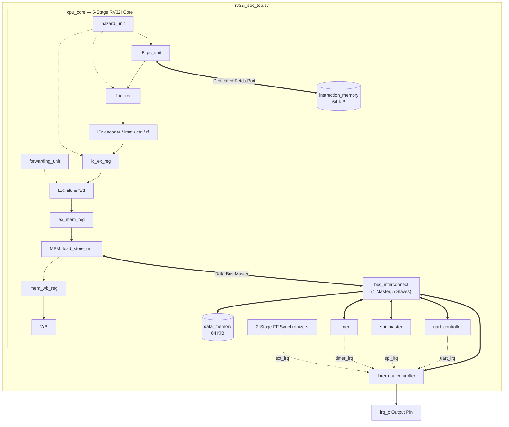

# SoC Architecture (Phase 4 — Fully Integrated)

> Status: Phase 4 Completed. All 22 modules implemented in synthesizable SystemVerilog RTL.

## Hierarchy
```text
rv32i_soc_top
├── cpu_core
│   ├── pc_unit                 (IF)
│   ├── if_id_reg               (IF/ID)
│   ├── instruction_decoder     (ID)
│   ├── immediate_generator     (ID)
│   ├── control_unit            (ID)
│   ├── register_file           (ID read / WB write)
│   ├── id_ex_reg               (ID/EX)
│   ├── alu                     (EX)
│   ├── ex_mem_reg              (EX/MEM)
│   ├── load_store_unit         (MEM)
│   ├── mem_wb_reg              (WB select)
│   ├── hazard_unit             (Hazard Detection & Stall/Flush)
│   └── forwarding_unit         (Operand RAW Forwarding)
├── instruction_memory          (64 KiB Dedicated Fetch RAM)
├── bus_interconnect            (1-Master, 5-Slave Crossbar & Decoder)
├── data_memory                 (64 KiB Byte-Masked RAM — Slave 0)
├── uart_controller             (8-N-1 Full Duplex — Slave 1)
├── spi_master                  (Motorola Modes 0-3, 4 CS — Slave 2)
├── timer                       (32-bit Counter, Compare Match — Slave 3)
├── interrupt_controller        (4-Source Sticky Aggregation — Slave 4)
└── synchronizers               (2-Stage FF Synchronizers on Async Inputs)
```

## Block Diagram



## Handshake Protocols
- **Instruction Memory**: Synchronous request (`req_i`), 1-cycle latency response (`ready_o`, `rdata_o`, `error_o`).
- **Data Bus Interconnect**: Single-master handshake (`valid_i`, `we_i`, `addr_i`, `wdata_i`, `be_i`) with slave response (`ready_o`, `rdata_o`, `error_o`). Unmapped addresses return `ready=1, error=1`.
