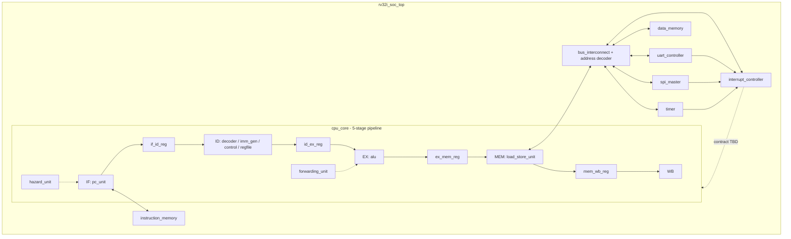

# SoC Architecture

> Status: architecture planning. No RTL exists.

## Hierarchy
```
rv32i_soc_top
├── cpu_core
│   ├── pc_unit                 (IF)
│   ├── if_id_reg
│   ├── instruction_decoder     (ID)
│   ├── immediate_generator     (ID)
│   ├── control_unit            (ID)
│   ├── register_file           (ID read / WB write)
│   ├── id_ex_reg
│   ├── alu                     (EX)
│   ├── ex_mem_reg
│   ├── load_store_unit         (MEM)
│   ├── mem_wb_reg              (WB select)
│   ├── hazard_unit
│   └── forwarding_unit
├── instruction_memory
├── bus_interconnect (address decoder + response mux)
├── data_memory
├── uart_controller
├── spi_master
├── timer
└── interrupt_controller
```

## Block diagram


## Data paths
- **Fetch:** `pc_unit` drives a dedicated read-only port to `instruction_memory`, so fetch never contends with data accesses.
- **Data:** `load_store_unit` is the only bus master. The decoder selects exactly one slave; unmapped addresses complete with `error`.
- **Interrupts:** peripherals raise level IRQs into `interrupt_controller`. How the CPU takes an interrupt is **TBD** (needs a trap/CSR decision).

## Bus protocol (proposed)
Master → slave: `req`, `addr[31:0]`, `we`, `wdata[31:0]`, `be[3:0]`. Slave → master: `ready`, `rdata[31:0]`, `error`.
The master holds all request signals stable until `req && ready` at a rising edge. One outstanding transaction. No bursts. This is not AXI.

## Clock and reset
Single clock `clk_i`. Synchronous active-low reset `rst_ni` (proposed). External asynchronous inputs (`uart_rx_i`, `ext_irq_i`, `spi_miso_i`) pass through two-flop synchronizers (proposed).
