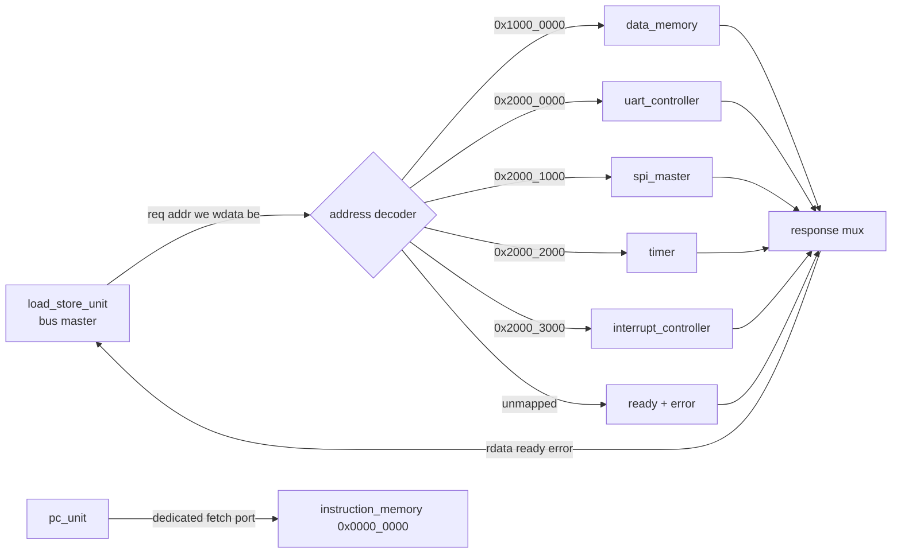

# Memory Map — PROPOSED, NOT FINAL

| Region | Start | End | Size | Access |
|---|---|---|---|---|
| Instruction memory | 0x0000_0000 | 0x0000_FFFF | 64 KiB (TBD) | Fetch port only |
| Data memory | 0x1000_0000 | 0x1000_FFFF | 64 KiB (TBD) | Bus, R/W |
| UART | 0x2000_0000 | 0x2000_0FFF | 4 KiB aperture | Bus |
| SPI master | 0x2000_1000 | 0x2000_1FFF | 4 KiB aperture | Bus |
| Timer | 0x2000_2000 | 0x2000_2FFF | 4 KiB aperture | Bus |
| Interrupt controller | 0x2000_3000 | 0x2000_3FFF | 4 KiB aperture | Bus |
| All other addresses | — | — | — | `ready` + `error`, no side effect |

## Peripheral registers (proposed)
Registers are 32-bit, word-aligned. Reserved bits read 0, writes ignored.

**UART @ 0x2000_0000** — 0x00 TXDATA (WO), 0x04 RXDATA (RO), 0x08 STATUS (RO), 0x0C CONTROL (RW), 0x10 BAUD_DIV (RW). FIFO depth and status bit layout TBD.

**SPI @ 0x2000_1000** — 0x00 TXDATA (RW), 0x04 RXDATA (RO), 0x08 STATUS (RO), 0x0C CONTROL (RW), 0x10 CLK_DIV (RW), 0x14 CS (RW). CPOL/CPHA modes, transfer width, number of chip selects TBD.

**Timer @ 0x2000_2000** — 0x00 COUNT (RO), 0x04 COMPARE (RW), 0x08 CONTROL (RW), 0x0C IRQ_STATUS (W1C).

**Interrupt controller @ 0x2000_3000** — 0x00 PENDING (RO), 0x04 ENABLE (RW), 0x08 CLEAR (W1C), 0x0C PRIORITY (TBD). Source numbering (proposed): 0 UART, 1 SPI, 2 Timer, 3 External.

Reset: all enables cleared (proposed). The linker script in `programs/linker/` must follow the signed-off map.
