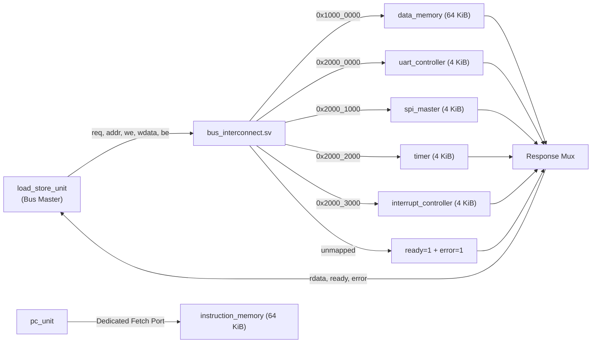

# Memory Map — Final Ratified (Phase 4)

| Region | Start | End | Size | Target / Slave Select | Access Permissions |
|---|---|---|---|---|---|
| **Instruction Memory** | `0x0000_0000` | `0x0000_FFFF` | 64 KiB | Dedicated Fetch Port | Read-Only (Fetch) |
| **Data Memory** | `0x1000_0000` | `0x1000_FFFF` | 64 KiB | `s0` (Slave 0) | Read / Write (Byte masked) |
| **UART Controller** | `0x2000_0000` | `0x2000_0FFF` | 4 KiB | `s1` (Slave 1) | Read / Write (MMIO) |
| **SPI Master** | `0x2000_1000` | `0x2000_1FFF` | 4 KiB | `s2` (Slave 2) | Read / Write (MMIO) |
| **Timer** | `0x2000_2000` | `0x2000_2FFF` | 4 KiB | `s3` (Slave 3) | Read / Write (MMIO) |
| **Interrupt Controller**| `0x2000_3000` | `0x2000_3FFF` | 4 KiB | `s4` (Slave 4) | Read / Write (MMIO) |
| **All other addresses** | — | — | — | Unmapped Logic | Returns `ready=1`, `error=1`, `rdata=0` |

## Peripheral Registers (Ratified Specifications)

Registers are 32-bit, word-aligned (`addr[1:0] == 2'b00`). Misaligned accesses assert `error`. Reserved bits read 0, writes ignored.

### 1. UART Controller (`0x2000_0000`)
- **0x00 `DATA`**: Write `TX_DATA[7:0]`; Read `RX_DATA[7:0]` (read-to-consume buffer).
- **0x04 `STATUS`**: bit 0: `rx_data_ready`, bit 1: `tx_busy`, bit 2: `rx_overrun` (W1C), bit 3: `rx_frame_error` (W1C).
- **0x08 `BAUD_DIV`**: 32-bit baud clock divider ($N = f_{\text{clk}} / \text{baud}$). Reset default = 868.
- **0x0C `CONTROL`**: bit 0: `rx_en`, bit 1: `tx_en`, bit 2: `irq_en`.

### 2. SPI Master (`0x2000_1000`)
- **0x00 `DATA`**: Write `TX_DATA[7:0]`; Read `RX_DATA[7:0]`.
- **0x04 `STATUS`**: bit 0: `done` (W1C), bit 1: `busy` (RO).
- **0x08 `CLK_DIV`**: 32-bit prescaler ($f_{\text{sclk}} = f_{\text{clk}} / (2 \times \text{DIV})$). Reset default = 10.
- **0x0C `CONTROL`**: bit 0: `enable`, bit 1: `cpol`, bit 2: `cpha`, bit 3: `irq_en`.
- **0x10 `CS_REG`**: bits [3:0]: Active-low chip select lines (`spi_cs_no[3:0]`). Reset default = `4'b1111`.

### 3. Hardware Timer (`0x2000_2000`)
- **0x00 `COUNT`**: RO, 32-bit counter value. Increments every clock cycle when enabled.
- **0x04 `COMPARE`**: RW, 32-bit compare threshold. Reset default = `0xFFFF_FFFF`.
- **0x08 `CONTROL`**: bit 0: `timer_en`, bit 1: `irq_en`.
- **0x0C `IRQ_STATUS`**: bit 0: `compare_match` flag (W1C).

### 4. Interrupt Controller (`0x2000_3000`)
- **0x00 `PENDING`**: RO, bits [3:0]: Sticky pending flags (0: UART, 1: SPI, 2: Timer, 3: External).
- **0x04 `ENABLE`**: RW, bits [3:0]: Source mask enables. Reset default = `0x0`.
- **0x08 `CLEAR`**: W1C, bits [3:0]: Write 1 to clear corresponding pending bit.
- **0x0C `PRIORITY`**: Reserved (reads 0).
