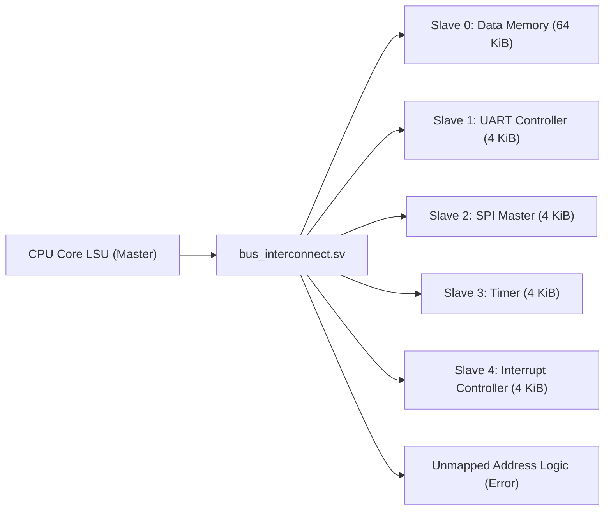

# Phase 4 Bus Architecture & Address Decoding

## 1. Interconnect Topology

The SoC utilizes a single-master, multi-slave crossbar interconnect (`bus_interconnect.sv`) connecting the CPU Load/Store Unit master to 5 slave subsystems.

---

## 2. System Memory Map

| Aperture / Peripheral | Base Address | End Address | Size | Slave Select | Access Permissions |
| :--- | :--- | :--- | :--- | :--- | :--- |
| **Instruction Memory** | `0x0000_0000` | `0x0000_FFFF` | 64 KiB | Dedicated Fetch | Read-Only (Fetch) |
| **Data Memory** | `0x1000_0000` | `0x1000_FFFF` | 64 KiB | `s0` (Slave 0) | Read / Write |
| **UART Controller** | `0x2000_0000` | `0x2000_0FFF` | 4 KiB | `s1` (Slave 1) | Read / Write (MMIO) |
| **SPI Master** | `0x2000_1000` | `0x2000_1FFF` | 4 KiB | `s2` (Slave 2) | Read / Write (MMIO) |
| **Timer** | `0x2000_2000` | `0x2000_2FFF` | 4 KiB | `s3` (Slave 3) | Read / Write (MMIO) |
| **Interrupt Controller**| `0x2000_3000` | `0x2000_3FFF` | 4 KiB | `s4` (Slave 4) | Read / Write (MMIO) |
| **Unmapped Space** | *All other addresses* | — | — | Error Generator | Returns `ready=1, error=1` |

---

## 3. Bus Protocol Specification

### Request Signals (Master -> Interconnect -> Selected Slave)
- `valid`: Initiates transfer when asserted high.
- `we`: Direction (1 = Write, 0 = Read).
- `addr[31:0]`: Target byte address.
- `wdata[31:0]`: 32-bit write payload.
- `be[3:0]`: Active-high byte enable lanes.

### Response Signals (Selected Slave -> Interconnect -> Master)
- `ready`: Transfer completion strobe.
- `rdata[31:0]`: 32-bit read payload.
- `error`: Fault indicator (unmapped space, misalignment, bus timeout).

### Arbitration & Routing Rules
1. Address decoding is purely combinational on the high bits of `addr[31:0]`.
2. Slave valid lines are strictly mutually exclusive (one-hot or all-zero).
3. Response multiplexing: when a slave is selected, its `ready`, `rdata`, and `error` lines are gated to the master.
4. When `m_valid_i` targets unmapped space, the interconnect asserts `m_ready_o = 1`, `m_error_o = 1`, `m_rdata_o = 32'h0` on the following cycle.
