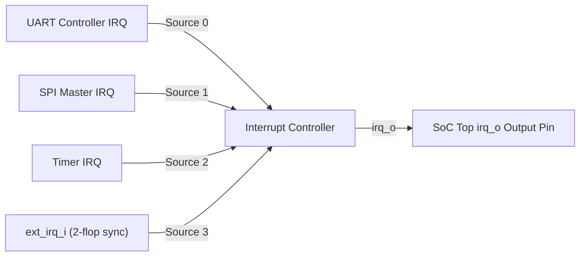

# Phase 4 Interrupt Architecture Specification

## 1. System Interrupt Model

In Phase 4, the RV32I SoC implements a centralized, memory-mapped Interrupt Controller (`interrupt_controller.sv`) mapped at `0x2000_3000`.

> [!NOTE]
> Processor interrupt handling (CSR registers `mstatus`, `mie`, `mip`, `mtvec`, `mepc` and trap vectors) is scheduled for Phase 5 (Privileged Architecture). In Phase 4, `irq_o` is exposed at the SoC boundary for external observation and verification.

---

## 2. Register Memory Map (Base: 0x2000_3000)

| Offset | Name | Type | Reset Value | Description |
| :---: | :--- | :---: | :---: | :--- |
| `0x00` | `PENDING` | RO | `0x0000_0000` | Bits [3:0]: Sticky pending flags for sources 0..3 |
| `0x04` | `ENABLE` | RW | `0x0000_0000` | Bits [3:0]: Source mask enable bits |
| `0x08` | `CLEAR` | W1C | `0x0000_0000` | Bits [3:0]: Write 1 to clear corresponding pending bit |
| `0x0C` | `PRIORITY` | RO | `0x0000_0000` | Reserved for Phase 5 priority arbitration |

---

## 3. Interrupt Channel Assignment

| Channel Bit | Source Peripheral | Trigger Condition |
| :---: | :--- | :--- |
| **Bit 0** | UART Controller | RX data ready, RX overrun, or framing error |
| **Bit 1** | SPI Master | 8-bit SPI transmission complete (`done`) |
| **Bit 2** | Timer | Counter reaches compare threshold (`compare_match`) |
| **Bit 3** | External Pin | Asynchronous `ext_irq_i` pin (synchronized via 2-stage FF) |

---

## 4. Hardware Behavior & Semantics

1. **Sticky Latching**:
   - Any active incoming source pulse is latched into `PENDING[i]`. Even if the peripheral source deasserts, `PENDING[i]` remains high until cleared by software.
2. **Masking & Aggregation**:
   - The aggregated interrupt output is computed combinational logic:
     $$\text{irq\_o} = \bigvee_{i=0}^{3} (\text{PENDING}[i] \ \wedge \ \text{ENABLE}[i])$$
3. **Write-1-to-Clear (W1C)**:
   - Writing a 1 to bit $i$ of `CLEAR` clears `PENDING[i]`.
4. **Set-Over-Clear Priority**:
   - If an incoming interrupt arrives in the same cycle as a W1C write targeting that channel, the hardware gives priority to the incoming interrupt: `PENDING[i]` remains `1`.
