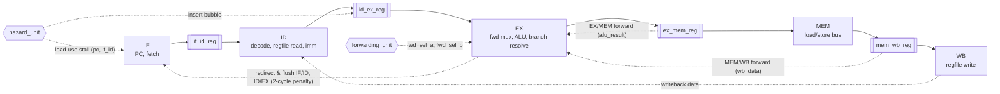

# Five-Stage Pipeline Architecture

> Status: RTL Implemented (Phase 3 Hazard Detection & Forwarding Integrated).

## Stages
| Stage | Work |
|---|---|
| IF | Select next PC (PC+4, branch/jump redirect, hold on stall), request instruction from memory |
| ID | Decode instruction, read rs1/rs2 from register file, generate immediate and control signals |
| EX | Forwarding muxes select latest operand values, ALU execution, branch comparison, branch/jump target calculation |
| MEM | Load/store over memory bus; byte enables and sign/zero extension; holds pipeline if `ready` is low |
| WB | Select ALU result / load data / PC+4 and write to register file via synchronous port |

## Pipeline Registers
| Register | Fields |
|---|---|
| `if_id_reg` | valid, pc, pc_plus4, instr |
| `id_ex_reg` | valid, pc, pc_plus4, rs1_data, rs2_data, imm, rs1_addr, rs2_addr, rd_addr, funct3, controls |
| `ex_mem_reg` | valid, pc_plus4, alu_result, rs2_data (forwarded store data), rd_addr, funct3, controls |
| `mem_wb_reg` | valid, rd_addr, reg_write, wb_data |

## Hazards & Resolution Mechanisms (Phase 3)
- **RAW (ALU result):** Resolved via `forwarding_unit`. Forwards from EX/MEM (`2'b10`, priority 1) or MEM/WB (`2'b01`, priority 2) into EX. Never forwards when `rd = x0` or `reg_write = 0`.
- **Load-use:** When ID/EX contains a load and its `rd` matches a used `rs1` or `rs2` in IF/ID, `hazard_unit` holds PC and IF/ID for 1 cycle and inserts a bubble into ID/EX. The load advances to MEM, and in the next cycle its data is forwarded from MEM/WB.
- **Store data:** Store data (`rs2`) is forwarded from `fwd_rs2_val` into `ex_mem_reg`, allowing back-to-back ALU-to-Store execution without stalls.
- **Branch operands:** Forwarded operands feed ALU inputs `alu_op_a` and `alu_op_b`, allowing conditional branches to evaluate freshly computed values immediately.
- **JALR base:** `jalr_target = (fwd_rs1_val + ex_imm) & ~32'd1` uses forwarded `rs1`.
- **Control hazard:** Taken branches and jumps resolve in EX. `redirect_valid` asserts, redirecting PC and asserting `flush_if_id` and `bubble_id_ex` (2-cycle branch penalty).
- **Bus wait (LSU busy):** When `lsu_busy` is high, all stages freeze synchronously. Stalls take precedence over flushes and bubbles.

## Stall / Flush Priority
Priority (highest to lowest):
1. **Reset (`!rst_ni`):** Clears all registers synchronously.
2. **Bus wait (`lsu_busy`):** Freezes all 5 stages; prevents flushes from corrupting pending redirect state.
3. **Load-use hazard:** Stalls PC and IF/ID; inserts single bubble into ID/EX.
4. **Control redirect:** Redirects PC to target; flushes IF/ID and ID/EX.
5. **Normal advancement:** Pipeline advances by 1 stage per rising clock edge.
