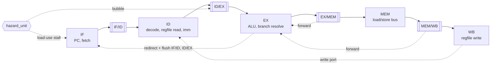
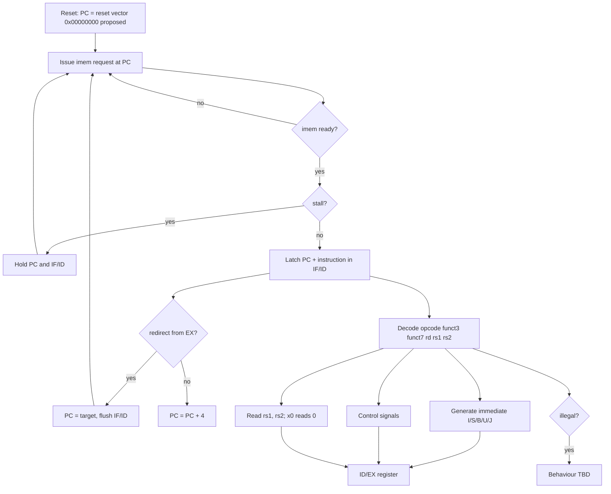

# Five-Stage Pipeline Architecture

> Status: proposal. Not implemented.

## Stages
| Stage | Work |
|---|---|
| IF | Select next PC, request instruction |
| ID | Decode, read rs1/rs2, generate immediate and controls |
| EX | ALU operation, branch compare, branch/jump target |
| MEM | Load/store over the bus; hold on `ready` low |
| WB | Select ALU / load / PC+4 and write the register file |

## Pipeline registers
| Register | Fields |
|---|---|
| IF/ID | valid, pc, instr |
| ID/EX | valid, pc, rs1_data, rs2_data, imm, rs1, rs2, rd, rs1_used, rs2_used, controls |
| EX/MEM | valid, alu_result, store_data, rd, pc_plus4, mem/wb controls |
| MEM/WB | valid, alu_result, load_data, pc_plus4, rd, reg_write, wb_sel |

## Hazards
- **RAW (ALU result):** forward from EX/MEM (priority) or MEM/WB into EX. Never forward when rd = x0.
- **Load-use:** if ID/EX is a load and its rd matches a used rs1/rs2 in IF/ID, hold PC and IF/ID one cycle and insert a bubble into ID/EX.
- **Control:** taken branch or jump in EX redirects PC and flushes IF/ID and ID/EX (2-cycle penalty, proposed).
- **Structural:** none on fetch vs data (separate ports). Bus wait holds the whole pipeline.

## Stall/flush priority (proposed, must be reviewed)
reset > redirect/flush > hold (bus wait, load-use) > advance. A redirect waits if an older memory operation is still in progress.

Flushed instructions must never write registers or memory. No fixed CPI is claimed.

## Fetch and decode flow

