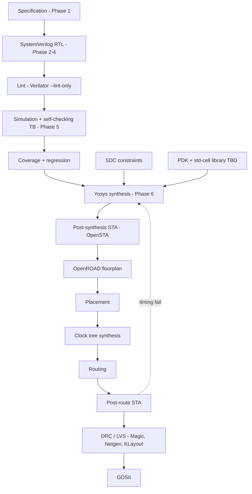

# Synthesis and Physical Design Preparation

> All files here are **templates**. No synthesis, STA, placement, routing or GDSII has been run. Area, timing and power numbers will appear only in `reports/` after real runs.

## Flow

## 1. RTL simulation
- Tools: Icarus Verilog (`iverilog -g2012`) or Verilator. Script: `scripts/run_sim.sh`.
- Waveforms: VCD/FST, viewed in GTKWave. Waveforms are git-ignored.

## 2. Yosys synthesis
- Script: `synthesis/yosys/synth.ys`. Generic synthesis first (`synth -top rv32i_soc_top`), then technology mapping with the chosen Liberty file (TBD).
- Outputs: gate-level netlist and `stat` report to `reports/synthesis/`.

## 3. Timing constraints
- File: `constraints/rv32i_soc.sdc`. Clock period **TBD** — chosen after first synthesis, not assumed.
- I/O delays, uncertainty and transition limits TBD per PDK.

## 4. OpenROAD physical design
- Config: `physical_design/openroad/config.mk` (ORFS-style) — floorplan utilization, aspect ratio, placement density TBD.
- Steps: floorplan → IO placement → global/detailed placement → CTS → global/detailed routing → filler → STA → DRC/LVS.

## 5. Area and timing reports
Required per run: commit hash, PDK and library version, tool versions, command, SDC, and report files. Template: `reports/REPORT_TEMPLATE.md`.

## 6. GDSII generation
Produced only by the real flow (OpenROAD/KLayout/Magic). DRC- and LVS-clean status must be backed by logs.
